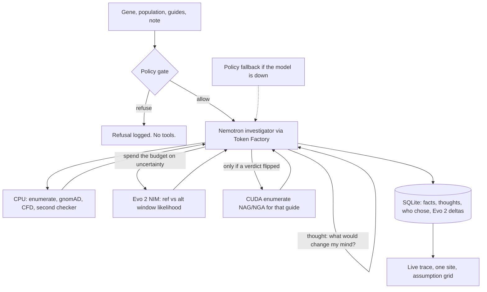

# CRISPR-Ops — Final plan

**Don't score the guide. Audit the assumption.**

CRISPR-Ops is a **method-and-workflow audit**, not a new predictor. Population-aware CFD already exists (CRISPRme / CRISPRme+). We win by showing **how often, and under which stated assumptions, a computational off-target conclusion changes** — with a re-derivable agent trace.

Submit **29 Oct 2026**. Official close is **30 Oct 2026, 10:00am PDT / 10:30pm IST**. Submissions cannot be edited after close.

Research use only. Not a diagnosis. Personal genomes are refused.

---

## 1. The claim (say this, nothing else)

> CRISPR-Ops audits how reference-only scoring, mismatch counting, and simplified haplotype rules change computational off-target conclusions under a named population's common variants, and records the investigation as a re-derivable trace. It reports nulls as results and makes no claim about real cutting.

**We are not:** a new search engine, a better CFD, a CRISPRme clone, a clinical screen, or a GPU demo that never ran.

**We are:** an investigator agent. Cheap CPU tools produce facts. Nemotron decides what is worth spending an expensive NVIDIA DNA model on, which disagreement to chase, and when the audit is done. Code still owns every number.

The chromosome 11 run is a **null and we keep it**: chr11:13061395 C>T, SAS AF 0.25, CFD 0.0391 → 0.0391, because the variant is the N of the PAM. That is a method finding. Do not hide it. Do not quote “15 of 125” until this codebase reproduces it.

---

## 2. What wins this track

Judges have two minutes. They need four proofs:

1. **Eligibility.** A live NVIDIA Nemotron call through **Nebius Token Factory** in the trace (model id, request id, latency, tokens). `NVIDIA_API_KEY` / build.nvidia.com does **not** count.
2. **Agency, not a dispatcher.** After each observation the model writes a hypothesis and picks **one** expensive next step from a legal set. Same input, **model vs policy** diff is non-empty: different site order, different hypothesis first, different Evo 2 spend.
3. **NVIDIA biology, not just an LLM.** Evo 2 (BioNeMo NIM) scores ref vs alt haplotype likelihood on sites the agent triaged. Label: sequence-context prior, **not** a cutting probability. A CFD–Evo 2 direction split is a finding.
4. **Science that survives a question.** Assumption grid on ≥20 guides × ≥3 populations. Verdicts in code. Nulls first-class. No “hides danger.” No accuracy claim vs CRISPRme.

---

## 3. System architecture



Cheap tools always run. Evo 2 and PAM expansion are **not** the next row in a DAG. The agent spends them when the last observation is unexplained or near τ.

**CUDA** is the systems GPU (string search). **Evo 2** is the biology GPU (DNA foundation model). They are different. Evo 2 is in the win path. CUDA is in if a Nebius GPU exists by 24 Oct; otherwise the expanded search stays on CPU and the trace names the device.

---

## 4. What the agent actually does

Tool calling is the *hands*. The work is the *thought* that chooses the hand.

After every observation the model must emit, and the trace must store:

1. **What I think is going on** (one sentence, no new numbers).
2. **What would change my mind.**
3. **One legal action** — or `finish`.

That is an investigation loop, not `enumerate → fetch → score → summarize`.

| Situation | Policy baseline (dumb DAG) | What Nemotron is for |
|---|---|---|
| 19 sites, one AF=0.25 overlap, ΔCFD = 0 | Stop. Print PAM_N. | Ask: is this the N of the PAM, or did we miss NAG 2 bp away? Spend `crispr_me_check` / PAM expand / Evo 2 on **this** window, not on every site. |
| Checker disagrees on minus strand | Test strand, window, and phasing | Pick **one** hypothesis. If it fails, revise. Demo: “I was wrong, trying window start.” |
| Several sites sit within 0.05 of τ = 0.2 | Call Evo 2 on the first four | Rank by “which disagreement would actually change a verdict,” spend the 4-call Evo 2 budget there. |
| CFD up, Evo 2 likelihood down | Ignore Evo 2 or treat it as truth | Record **direction split**. Do not change the CFD verdict. Optionally re-check the window. |
| Guide flipped CLEAR → FLAGGED | Always expand NAG/NGA | Confirm expansion for that guide, or spend remaining budget on another population first. Both are legal. Record the choice. |
| Budget 3 calls left | Keep walking the DAG | `finish` if the grid is complete; otherwise one more sensitivity (AF 0.01 **or** weighted haplotype, not both). |

If the model-vs-policy trace is identical, the agent did not work. Widen the legal set until the traces diverge, then show the diff.

The model still **never** writes a CFD, an AF, or a verdict. If it names a number that is not in the observation, drop the thought and keep the policy action.

---

## 5. Who decides what

| Decision | Owner | Why |
|---|---|---|
| Refuse personal genome / clinical note | Code, before any tool | Model must not loosen a refusal |
| Allele frequency, CFD, mismatch counts | Data + code | Never from model memory |
| FLAGGED / CLEAR / INCONCLUSIVE, τ flips | Code | τ = 0.2, registered before the run |
| NAG/NGA expansion **allowed** | Registered rule in code | Flip, or corrected checker still disagrees, for **that guide only** |
| Whether to **spend** the allowed expansion now, vs another population | **Model** | Both are legal; the choice is the work |
| Which sites get Evo 2 (budget 4) | **Model**, inside a code cap | CPU triage is a suggestion, not a DAG |
| Which legal guide / disagreement to handle first | **Model** | Several orders are valid |
| Which hypothesis to test first (strand, window, phasing) | **Model proposes, code tests** | Self-correction is the demo moment |
| Which extra sensitivity to add (AF 0.01, weighted haplotype) | **Model**, inside budget | All options are legitimate |
| Report prose | Model drafts from the record; `verify_citation` filters | Readability without authority |
| Any number in the UI | Template from the run record | Drop the sentence if the number is missing |

Illegal tool calls return a structured error even if the prompt asked for them. Two parse failures → policy override, logged. Two Token Factory failures → policy finishes the run, banner: **no model was used**.

---

## 6. Tech stack

| Layer | Choice | Notes |
|---|---|---|
| Language | Python 3.11 | NAT does not support 3.14 |
| Agent | NeMo Agent Toolkit `react_agent` | 40 tool calls, temperature 0. Native tools only if Token Factory tool-calling actually works; otherwise text-JSON ReAct |
| LLM | NVIDIA Nemotron, **id copied from Token Factory `/v1/models`** | OpenAI-compatible client. Env: `NEBIUS_API_KEY` |
| API / UI | FastAPI + existing paper/ink UI | Stream the trace. Export JSON/CSV |
| Store | SQLite | One row per tool step + full score tables |
| Enumerator | `cpp/enumerate.cpp` | PAM-skip and full scan must match. Device named in the trace |
| Variants | gnomAD v4 GraphQL, disk cache | Missing AF = `unavailable`, never 0. Pre-warm the demo panel |
| Score | Doench 2016 CFD JSON tables | Unit-test against published poly-G vector and CRISPOR/crisprScore if possible |
| DNA model | **Evo 2** via BioNeMo NIM (`evo2-7b/forward`) | Mean log-prob of ref vs alt window. Agent-gated. Not a cutting probability |
| GPU search | `cuda/enumerate.cu` when a GPU exists | Same hit contract as CPU. Optional. Trace names the device |
| Second checker | In-repo enumerator | Label it that. Never “agrees with CRISPRme+” unless `CRISPRME_BIN` ran |
| Genome | GRCh38 FASTA for chromosomes the panel hits | Today: chr11 only. Expand only as far as the 20-guide panel needs |
| Tests | pytest | Refusal, strand correction, flip→escalation, citation, illegal-tool reject, Evo 2 stub |

**NVIDIA biology: use Evo 2. Do not bolt on protein/chem NIMs.** ESMFold, AlphaFold, MolMIM, DiffDock answer a different question. Off-target CRISPR is DNA sequence context. Evo 2 is the model NVIDIA trained for that.

**Still cut:** Tavily, GUIDE-seq unless a real TSV exists, claiming CUDA speedups before a timed run.

---

## 7. The scientific product (the table judges remember)

For each guide × population, report:

| Assumption | What changes |
|---|---|
| Mismatch count vs CFD | Did ranking or the τ verdict move? |
| AF cutoff 0.01 vs 0.05 | How many “common” overlaps appear? |
| Top-SNV haplotype vs AF-weighted expected CFD | Does the “population” window still look like a majority? |
| NGG vs NAG/NGA | Only after a registered flip for that guide |
| CFD Δ vs Evo 2 Δ | Same direction, split, or Evo 2 unavailable. Split is reported, never “Evo 2 wins.” |

**Minimum n:** 20 guides, ≥3 genes, ≥3 gnomAD groups (e.g. SAS, AFR, NFE). Report **counts** of flips and re-rankings. If n is small, no p-values.

**Nulls are first-class.** Reason codes on delta 0 (example: `PAM_N`). INCONCLUSIVE if a disagreement is unexplained within budget.

**Qualitative check (if the site is easy to obtain):** Cancellieri et al. CPS1 / rs114518452, CFD 0.02 → 0.95. Use as a sanity check, not as our result.

Haplotype rule: primary = highest-AF SNV in the 23 bp window. Also report AF-weighted expected CFD. Treat AF > 0.5 as the major allele. gnomAD does not phase the window.

---

## 8. Resources

| Resource | Role | Required? |
|---|---|---|
| `NEBIUS_API_KEY` + Token Factory base URL **from the console** | Eligible Nemotron calls | **Yes** |
| Nemotron model id from `GET /v1/models` | Do not invent the slug | **Yes** |
| Proof: 1 chat + 1 tool-call, saved | Eligibility evidence | **Yes, today** |
| NeMo Agent Toolkit + langchain extra (already in `.venv`) | Workflow YAML judges can `nat validate` | Should |
| GRCh38 FASTA for panel chromosomes | Enumeration | Yes, as needed |
| gnomAD cache for the frozen panel | Demo must not wait on ~10 qpm | Yes |
| SQLite file of a frozen demo run | Judges through Dec 15 without spend | Yes |
| Nebius credits (~$25 + $25, confirm in console) | Tens of calls per run; hard per-run cap | Yes, small |
| `CRISPRME_BIN` | Independent CFD comparison | Optional |
| Evo 2 NIM (NVIDIA biology API / BioNeMo) | Agent-gated second axis | **Yes for the win path.** Cached scores for the demo panel if live NIM is down |
| NVIDIA GPU on Nebius (optional) | Compile and time `enumerate_gpu` | Should, if a GPU instance is in the credit |
| GUIDE-seq TSV | Spearman vs ranking | Only if real data exists |

Never commit keys. Daily spend guard. Cached demo is the default path for judging.

---

## 9. Eligibility trap (do this first)

```bash
# URL from the Nebius console, not from memory
curl -s "$NEBIUS_BASE_URL/v1/models" \
  -H "Authorization: Bearer $NEBIUS_API_KEY" | python -m json.tool | grep -i nemotron
```

Then one chat completion and one tool-call against **that** id. Record whether native tools work.

- `NVIDIA_API_KEY` / integrate.api.nvidia.com / Hugging Face / OpenRouter → **not eligible**.
- If unsure, ask on Devpost/Discord **before** writing more agent code.

NAT YAML: `_type: openai`, `base_url` from console, `api_key: ${NEBIUS_API_KEY}`, `model_name:` copied id. Keep `react_agent`. Switch to native tools only after step 0 proves them.

---

## 10. Build order (freeze science 24 Oct)

| When | What | Done when |
|---|---|---|
| **Day 0 (today)** | Token Factory list + chat + tool-call. Point NAT at it. | Trace row has model id + request id |
| **Day 1–2** | SQLite run record. Every step: **thought**, chooser, legal set, result id | Replay a run from disk |
| **Day 2–3** | Evo 2 NIM on 4 triaged windows. Cache the logits. Wire “direction vs CFD.” | A real Evo 2 row in the trace, or `unavailable` with the reason |
| **Day 3–5** | Model vs policy A/B. Illegal-choice injection. Agent must pick Evo 2 sites, not inherit a list | Non-empty diff that includes Evo 2 spend or hypothesis order |
| **Day 5–10** | 20×3 panel, assumption grid, pre-warm gnomAD. CFD unit tests. Optional CPS1 check | Table with flip/re-rank counts. Nulls labelled |
| **Day 10–13** | UI: live thought+act trace, one-site card with Evo 2 line, grid, export, fallback banner | Two-minute demo works from cache |
| **By 24 Oct** | Optional: time CUDA vs CPU on a Nebius GPU. Equal hits required | No speed claim without the number |
| **29 Oct** | Submit. Cached demo. Limitations appended by code | Cannot edit after 30 Oct |

---

## 11. Two-minute demo (backwards from the clock)

| Time | On screen | Do not say |
|---|---|---|
| 0:00–0:20 | “The reference sequence is an assumption. CFD can move at constant mismatch count — or not move at all, if the variant is the N of the PAM.” Show the chr11 null. | “The reference is a lie.” “Hides danger.” “72% of the population.” |
| 0:20–1:00 | Type gene + population. Trace shows **Thought** then **Action**. Model picks strand, code tests, re-run agrees. Then the model spends Evo 2 on a near-τ site, not on every site. | That the second checker is CRISPRme+. That Evo 2 is a cutting score. |
| 1:00–1:30 | One site: ref vs alt window, CFD before/after, reason code, **Evo 2 Δ vs CFD Δ** (same direction / split / unavailable). Then the assumption grid. | Any GUIDE-seq correlation we did not compute |
| 1:30–2:00 | Model vs policy diff: policy would have tested all three hypotheses and skipped Evo 2; the agent did not. Token Factory + Evo 2 request ids. Limitations. | CUDA speedups we did not measure. “More accurate than CRISPRme.” |

If Token Factory is down, run the cached record and the banner. That is still a complete audit.

---

## 12. Claim hygiene (print next to the demo laptop)

**Allowed**

- “Under CFD, this variant raises / lowers / does not change the site score.”
- “This verdict is stable / unstable under these stated assumptions.”
- “No common variant overlapped these windows.”
- “Delta 0 because the substitution is the PAM N.”
- “Model chose strand first; policy would have tested all three. Calls saved: N.”
- “Evo 2 likelihood shifted with / against the CFD delta. That is a sequence prior, not a cutting probability.”

**Forbidden**

- Variant-aware off-target analysis is new / we are first
- More accurate than CFD or CRISPRme
- Guide is Casgevy / exa-cel
- gnomAD gives an individual’s haplotype
- In-repo checker validates against CRISPRme+
- GPU-accelerated (unless timed), GUIDE-seq r = anything we did not compute
- Evo 2 “confirms cutting” / is ground truth
- ESMFold / AlphaFold / MolMIM used on this problem
- Any clinical or safety sentence
- “15 of 125” until `pytest` + one command reproduce it in **this** repo

Every sentence in the report goes through `verify_citation`. Failures are dropped and logged. The limitations block is appended by **code**, not by the model.

---

## 13. Team split

| Person | Owns | Definition of done |
|---|---|---|
| **Andrew** | Enumerator, CFD tests, disagreement resolver, assumption-grid stats | Equal hit lists; published CFD vector; grid CSV from one command |
| **Nitin** | Token Factory + NAT, thought+act trace, model-vs-policy diff, Evo 2 NIM client | Eligible Nemotron call; Evo 2 row in the trace; A/B artifact |
| **Anant** | UI (thoughts, Evo 2 line, grid), refusal, citation filter, cached-demo path | Two-minute path works with APIs down |

One owner for the Devpost blurb: the claim in §1, unchanged.

---

## 14. Definition of a 10/10 submission

Ship only if **all** of these are true:

- [ ] Live Token Factory Nemotron call in a stored trace (or a labelled cached replay)
- [ ] Every step has a **thought** plus an action. Model vs policy traces differ
- [ ] Illegal model choice rejected and logged
- [ ] Evo 2 ran on agent-chosen sites (≤4). Direction vs CFD is on the one-site card. Unavailable is labelled, never faked
- [ ] ≥20 guides × ≥3 populations assumption grid, including the chr11 PAM-N null
- [ ] τ, AF cutoff, haplotype rule printed as registered before the run
- [ ] Refusal demo (clinical note) with no tool calls after the gate
- [ ] Exports: JSON run record + CSV grid
- [ ] Limitations list generated by code
- [ ] README one-liner matches §1
- [ ] No CUDA speedup, GUIDE-seq r, or “15 of 125” unless that artifact is in the repo

CUDA is extra credit after the list above is green. Protein/chem NIMs stay out.
