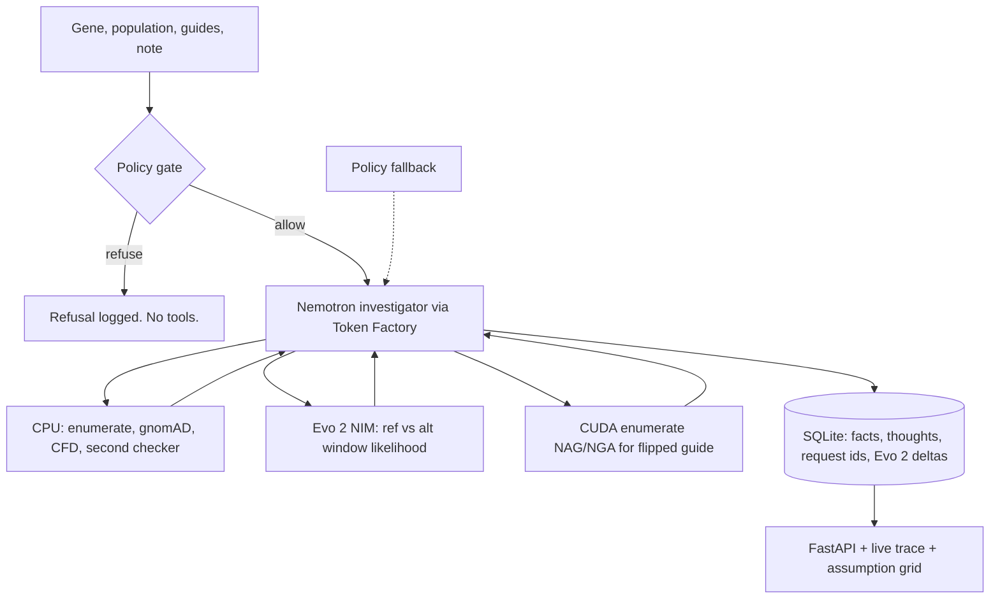

# CRISPR-Ops

[](https://www.python.org/)
[](./tests)
[](./LICENSE)

> **CRISPR-Ops audits how reference-only scoring, mismatch counting, and simplified haplotype rules change computational off-target conclusions under a named population's common variants, and records the investigation as a re-derivable trace. It reports nulls as results and makes no claim about real cutting.**

Research use only. Not a diagnosis. Personal genomes are refused.

---

## What this project does

CRISPR off-target scores are usually computed against the reference genome. But a common variant can change the CFD score without changing the mismatch count, or leave the score unchanged because the variant hits the flexible `N` of the PAM. CRISPR-Ops treats these as **method findings**, not safety conclusions, and records every thought, tool choice, and number in an auditable trace.

Key features:

- **Investigator agent:** Nemotron (via Nebius Token Factory) chooses which expensive next step is worth taking — Evo 2, PAM expansion, or a recheck — but code owns every number.
- **Cheap CPU tools:** enumeration against GRCh38, gnomAD v4 allele frequencies, Doench 2016 CFD scoring, and a second in-repo checker.
- **Evo 2 second opinion:** BioNeMo NIM scores ref-vs-alt window likelihood on the agent-triaged sites. Labelled as a **sequence-context prior**, not a cutting probability.
- **Assumption grid:** exportable CSV/JSON table across guides, populations, and assumptions.
- **Re-derivable trace:** every run is stored in SQLite with thoughts, legal sets, and request ids.

## Architecture



## Quick start

```bash
# Clone and create a virtual environment
git clone <repo-url>
cd crispr-ops
python3.11 -m venv .venv
.venv/bin/pip install -e ".[nat]"

# Download GRCh38 chr11 (the demo panel is on chr11)
curl -L -o data/genome/chr11.fa.gz https://hgdownload.soe.ucsc.edu/goldenPath/hg38/chromosomes/chr11.fa.gz
gunzip -kf data/genome/chr11.fa.gz

# Run the web demo
PYTHONPATH=src .venv/bin/python -m popoff.cli serve
```

Open http://127.0.0.1:8000 and run the audit.

### Other commands

```bash
# Single audit
PYTHONPATH=src .venv/bin/python -m popoff.cli audit --gene HBB --population sas

# Assumption grid for the full panel
PYTHONPATH=src .venv/bin/python -m popoff.cli panel --grid data/grid.csv --sites data/grid_sites.csv

# Benchmark CPU / GPU enumeration
PYTHONPATH=src .venv/bin/python -m popoff.cli bench

# Prove eligibility (requires Nebius Token Factory keys)
PYTHONPATH=src .venv/bin/python scripts/prove_eligibility.py

# Model vs policy A/B diff
PYTHONPATH=src .venv/bin/python scripts/ab_diff.py

# Run tests
PYTHONPATH=src .venv/bin/python -m pytest
```

## Eligibility for the NVIDIA track

The project uses **NVIDIA Nemotron through Nebius Token Factory**.

```bash
export NEBIUS_API_KEY="..."        # from the Nebius console
export NEBIUS_BASE_URL="..."        # from the Nebius console
PYTHONPATH=src .venv/bin/python scripts/prove_eligibility.py
```

This writes `data/eligibility_trace.json` containing the model id, request id, latency, and token usage. `NVIDIA_API_KEY` / `integrate.api.nvidia.com` is kept as a legacy fallback but does not satisfy the eligibility rule.

## Model vs policy diff

The A/B diff shows that Nemotron is acting as an investigator, not a dispatcher:

```bash
PYTHONPATH=src .venv/bin/python scripts/ab_diff.py
```

With Nebius keys, the script runs the same audit once with Nemotron and once with the registered policy, then compares Evo 2 spend and hypothesis order. The traces should differ.

## Scientific product

For each guide × population, the audit reports:

| Assumption | What changes |
|---|---|
| Mismatch count vs CFD | Did ranking or the τ verdict move? |
| AF cutoff 0.01 vs 0.05 | How many "common" overlaps appear? |
| Top-SNV haplotype vs AF-weighted expected CFD | Does the "population" window still look like a majority? |
| NGG vs NAG/NGA | Only after a registered flip for that guide |
| CFD Δ vs Evo 2 Δ | Same direction, split, or Evo 2 unavailable |

Minimum target: 20 guides × 3 populations. The repo ships a starter panel in `data/panel.json`.

## Project status

- Engine, policy gate, second checker, and SQLite trace: done
- Token Factory eligibility helper and A/B diff: done
- Assumption grid CSV/JSON export: done
- Live Nemotron/Evo 2 traces: need Nebius keys to capture
- Full 20-guide panel: needs real guide spacers added to `data/panel.json`

## Tech stack

| Layer | Choice |
|---|---|
| Language | Python 3.11 |
| Agent | NeMo Agent Toolkit `react_agent` |
| LLM | NVIDIA Nemotron via Nebius Token Factory |
| UI | FastAPI + Server-Sent Events |
| Store | SQLite |
| Enumerator | C++ CPU (`cpp/enumerate.cpp`), optional CUDA (`cuda/enumerate.cu`) |
| Variants | gnomAD v4 GraphQL with disk cache |
| DNA model | Evo 2 via BioNeMo NIM (`evo2-7b/forward`) |

## Tests

```bash
PYTHONPATH=src .venv/bin/python -m pytest
```

Covers refusal, strand/window/phasing correction, flip→escalation, illegal tool rejection, citation filtering, and the panel grid.

## Claim hygiene

We say:

- "Under CFD, this variant raises / lowers / does not change the site score."
- "This verdict is stable / unstable under these stated assumptions."
- "Evo 2 likelihood shifted with / against the CFD delta. That is a sequence prior, not a cutting probability."

We do **not** say:

- Variant-aware off-target analysis is new / we are first
- More accurate than CFD or CRISPRme
- Evo 2 confirms cutting
- GPU-accelerated (unless timed)
- Any clinical or safety sentence

## License

MIT
